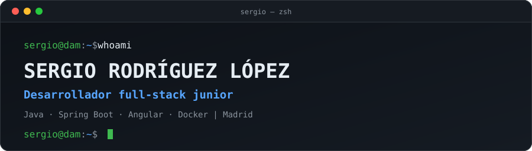

<div align="center">



<a href="https://github.com/sergiorodriguez-32">
  
</a>


</div>

## `$ whoami`

```yaml
nombre:      Sergio Rodríguez López
rol:         Desarrollador full-stack junior
estudios:    DAM (Desarrollo de Aplicaciones Multiplataforma) · 2.º curso
ubicacion:   Leganés, Madrid
busco:       Prácticas (FCT) de desarrollo · marzo 2027
idiomas:     Español (nativo) · Inglés (técnico)
trasfondo:   Años de trato con clientes y coordinación de equipos antes de programar
```

## `$ cat tech-stack.yaml`

```yaml
backend:
  - Java · Spring Boot · Spring Security · JPA/Hibernate · JWT · API REST · JUnit
frontend:
  - Angular · TypeScript · HTML5 · CSS
datos:
  - SQL · PL/SQL · MySQL · PostgreSQL
herramientas:
  - Git · GitHub · Maven · Docker
```

<p>
  
</p>

## `$ ls projects/`

| Proyecto | Qué es | Stack |
| --- | --- | --- |
| 🛒 [**Lista Compra Melit**](https://github.com/sergiorodriguez-32/Lista_Compra_Melit) | App full-stack de despensa y lista de la compra, hecha en equipo de 2 durante mis prácticas de 1.º de DAM | `Spring Boot` `Angular` `MySQL` `JWT` `Docker` |
| 🚗 [**CRM Drive Flow**](https://github.com/sergiorodriguez-32/CRM-concesionario-Drive-Flow) | Gestión de clientes, vehículos y ventas para un concesionario | `Java` `MySQL` `HTML` `CSS` |
| ✂️ [**Barbería Brothers**](https://barberia-brothers.vercel.app/) | PWA desarrollada para una barbería real: citas online, agenda y facturación. Desplegada y en fase de pruebas con el barbero. Repositorio privado, disponible bajo petición | `React` `FastAPI` `PostgreSQL` `Supabase` |

## `$ git status`

```text
En la rama: aprendiendo
  ▸ Reconstruyendo un proyecto con Spring Boot + Angular desde cero (seguridad, JPA, API REST y tests)
  ▸ Practicando inglés técnico a diario
  ▸ Buscando prácticas FCT de desarrollo en Madrid
```

## `$ connect --contact`

<p>
  <a href="https://www.linkedin.com/in/sergio-rodriguez-dev/"></a>
  <a href="mailto:sergiocode8@gmail.com"></a>
  <a href="https://barberia-brothers.vercel.app/"></a>
</p>

<div align="center">

<sub>Hecho desde Madrid · Leganés</sub>

</div>
